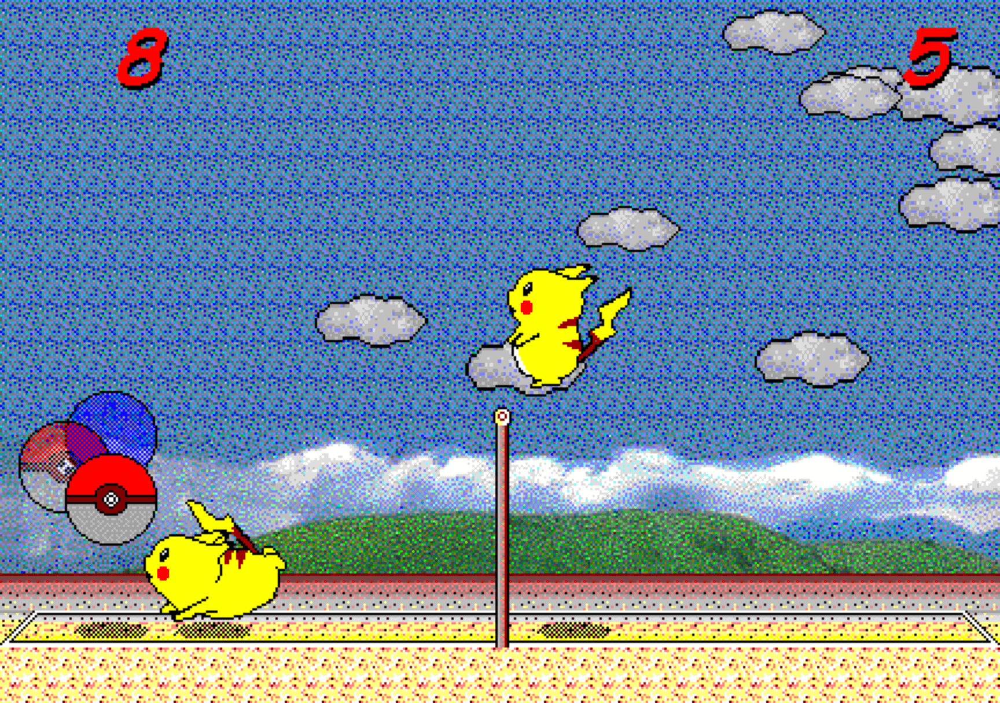

# 피카츄 배구

[_English_](README.md) | _&check;_ _Korean(한국어)_

피카츄 배구(対戦ぴかちゅ～　ﾋﾞｰﾁﾊﾞﾚｰ編)는 "(C) SACHI SOFT / SAWAYAKAN Programmers"와 "(C) Satoshi Takenouchi"가 1997년에 만든 윈도우용 게임입니다. 여기에 있는 소스 코드는 이 원조 피카츄 배구 게임의 머신 코드 주요 부분(물리 엔진과 AI 등)을 리버스 엔지니어링하여 자바스크립트로 구현한 것입니다.

https://gorisanson.github.io/pikachu-volleyball/ko/ 에서 이 피카츄 배구를 플레이할 수 있습니다.



## 로컬 환경에서 실행하는 방법

1. 본 저장소를 클론하고 해당 디렉토리로 들어갑니다.

```sh
git clone https://github.com/gorisanson/pikachu-volleyball.git
cd pikachu-volleyball
```

2. 의존하는 패키지를 설치합니다. (오류가 발생한다면, `node v16`와 `npm v8`을 사용해보세요.)

```sh
npm install
```

3. 코드를 번들링 합니다.

```sh
npm run build
```

4. 로컬 웹 서버를 실행합니다.

```sh
npx http-server dist
```

5. 웹 브라우저에서 로컬 웹 서버로 접속합니다. (대부분의 경우, 서버에 접속하기 위한 URL은 `http://localhost:8080` 입니다. 정확한 URL은 터미널에 출력된 메시지에서 확인할 수 있습니다.)

## 단일 봇 오프라인 DQN 학습

오프라인 학습과 플레이는 별도 과정입니다. 브라우저 게임은 내보낸 JSON 가중치로 추론하고, 사람과 플레이하는 동안 생긴 결과로 브라우저 안에서만 작은 로컬 업데이트를 할 수 있습니다. 이 업데이트는 오프라인 체크포인트나 배포용 모델 파일을 변경하지 않습니다. GPU 학습은 여러 랠리의 물리를 CuPy CUDA 커널에서 병렬 시뮬레이션하고 DQN도 GPU에서 갱신합니다. 실제 플레이는 기존 JavaScript 물리 엔진을 사용합니다.

CUDA 13.x NVIDIA 드라이버가 있는 Windows에서 GPU 학습 환경을 만들고 학습을 시작합니다.

    py -3.12 -m venv .venv
    .venv\Scripts\python.exe -m pip install -r requirements-gpu.txt
    $env:PIKA_DEVICE = 'cuda'
    npm run train

GPU 트레이너는 프로젝트 `.venv`를 자동으로 사용합니다. 기존 CPU 물리 시뮬레이션으로 학습하려면 Python에 `requirements.txt`를 설치하고 `npm run train:cpu`를 실행합니다. `PIKA_DEVICE=cpu`로 NumPy 사용을 강제할 수 있습니다.

학습 상대는 기존 내장 hard AI 대신 [AlphaChu-v1](https://huggingface.co/alphachu-volleyball/alphachu-v1) 고정 ONNX 모델입니다. 모델은 로컬 파일인 `checkpoints/alphachu-v1/model.onnx`에서 실행됩니다. 파일이 없을 때만 내려받고 SHA-256을 확인한 뒤, 프로세스를 시작할 때 한 번 GPU 메모리로 옮깁니다. 랠리 중 추론에는 원격 서비스를 호출하지 않습니다. AlphaChu 어댑터는 제작팀의 `alphachu-volleyball/pika-zoo` 규약에 맞춰 13개 P1 행동 매핑과 관측값 정규화 범위를 사용합니다. 이는 이전에 연결했던 구형 `helpingstar/pika-zoo` 규약과 다릅니다.

학습 버전 14는 `checkpoints-v6-alphachu/latest.npz`에 저장합니다. 새 학습은 이전 `checkpoints-v5-alphachu/best-bot.json`의 가중치를 AlphaChu 상대로 다시 평가한 뒤 출발 모델로 사용할 수 있습니다. 새 replay에는 5단계 누적 보상과 부트스트랩 할인 계수를 저장하므로, 기존 replay는 새 형식으로 불러오지 않고 버립니다. 참조 경험은 누적 보상과 다음 상태를 포함한 전체 TD 전이가 같은 경험을 중복 제거해 최대 50,000개 보관합니다. 이는 TD 학습에 쓰는 경험 데이터이며, 행동 모방 손실이나 정책을 고정하는 장치가 아닙니다.

GPU 기본 설정은 5단계 Double DQN, 배치 크기 1,024, 수집한 전이당 학습 표본 1개, 업데이트 250회마다 타깃 네트워크 갱신, 학습률 `0.00002`입니다. 마지막에만 주는 `-1/+1` 보상에 맞춰 GPU의 부트스트랩 값과 TD 목표를 `[-1, 1]`로 제한합니다. 기존 모델의 Q값이 지나치게 크면 출력층을 양수 배율로 한 번 조정하며, 같은 조건의 평가에서 기존 성능이 유지될 때만 적용합니다. 이 변경으로 승률 70%를 달성했다는 의미는 아닙니다.

탐험 확률은 `0.05`에서 시작해 새로 기록한 탐험 300,000랠리에 걸쳐 `0.01`로 줄어듭니다. 탐험 진행도는 기존 모델의 랠리 수 및 롤아웃 난수 시드와 따로 관리합니다. 같은 고정 AlphaChu를 상대하면서도 다양한 경기 경로를 수집하도록 시작 시 최대 16프레임의 무작위 유효 행동을 적용합니다. 평가는 학습 10,000랠리마다 완료된 GPU 배치 뒤에 수행하며, 기본 시작 상태와 같은 시드의 무작위 시작 구간을 적용한 상태를 모두 비교합니다. 시작 구간 이후에는 탐험을 끄고, 두 평가의 랠리 승률 평균으로 모델을 선택합니다. 이는 15점제 한 경기의 승률이 아니라 독립 랠리 득점률입니다. 로그에는 서브한 쪽에 따른 승률, 공 접촉·네트 통과 횟수, Q값·TD 오차 진단과 롤아웃·업데이트·평가·저장 시간이 표시됩니다. 기존 내장 hard AI는 50,000랠리마다 별도 확인용으로 평가합니다.

평균 선택 점수가 높아지고 기본 시작 상태의 성능도 유지될 때 새 챔피언으로 채택합니다. 기본 시작 승률 또는 평균 점수가 챔피언보다 5%p 이상 떨어지면, 실패한 후보의 전체 NPZ 체크포인트와 JSON 진단 보고서를 먼저 저장합니다. 보고서에는 확인 가능한 경우 정책이 처음 다른 행동을 선택한 지점도 포함합니다. 이후 최고 모델로 복구하고 학습을 멈춥니다. 최고 평가 모델은 플레이용 `bot.json`으로 내보냅니다. 체크포인트는 25,000랠리마다 완료된 GPU 배치 뒤에 저장하며, `Ctrl+C`로 중지하면 완료된 재개용 저장분을 남깁니다.

옵션은 `npm run train -- --episodes 5000000 --env-count 2048`처럼 전달합니다. `--episodes`는 기존 모델의 랠리를 포함한 총 목표이며, 로그의 `run +...`는 현재 프로세스에서 새로 수집한 랠리 수입니다. GPU 학습 옵션은 다음과 같습니다.

| 옵션 | 기본값 |
| --- | --- |
| `--n-step` | `5` |
| `--batch-size` | `1024` |
| `--samples-per-transition` | `1.0` |
| `--target-update-interval` | `250` |
| `--learning-rate` | `0.00002` |
| `--epsilon-start` / `--epsilon-min` | `0.05` / `0.01` |
| `--epsilon-decay-rallies` | `300000` |
| `--random-prefix-frames` | `16` |
| `--eval-every` / `--checkpoint-every` | `10000` / `25000` |
| `--checkpoint-dir` | `checkpoints-v6-alphachu` |

플레이용 기본 모델은 `src/resources/assets/ai/bot.json` 하나이며 게임 빌드에 포함됩니다. 플레이 중 사람과의 랠리 결과로 봇이 소량 온라인 학습하고, 갱신한 가중치는 현재 브라우저의 `localStorage`에 저장합니다. 이는 오프라인 체크포인트나 배포용 `bot.json`을 변경하지 않습니다. 화면 아래의 `인게임 학습 초기화` 버튼으로 이 브라우저의 적응 가중치를 버리고 기본 모델로 되돌릴 수 있습니다. 봇은 공 위치와 속도뿐 아니라 게임 엔진이 계산한 예상 낙하지점도 입력으로 사용합니다. `npm start`로 게임을 실행하고 `npm run build`로 배포 파일을 만들 수 있습니다. 봇 파일이 없으면 기본 내장 hard AI를 사용합니다.

Windows에서 체크포인트 교체가 파일 잠금으로 거부되면 잠시 재시도합니다. 잠금이 유지되면 완성된 저장분을 같은 폴더의 `latest.npz.pending-*` 같은 복구 파일로 남기고 학습을 계속합니다. 재실행 시 기본 파일과 복구 파일 중 가장 최근에 완료된 저장분을 읽습니다. `.writing-*`는 자동 복구 대상이 아닙니다. 플레이용 `bot.json` 교체가 잠긴 경우에는 복구본 경로와 브라우저용 파일이 아직 바뀌지 않았다는 메시지를 출력합니다.

## 게임 구조

- 물리 엔진: 공과 플레이어(피카츄)의 위치를 계산하는 물리 엔진은 [`src/resources/js/physics.js`](src/resources/js/physics.js) 파일에 담겨 있습니다. (플레이어가 컴퓨터와 대전 시 컴퓨터의 키보드 입력을 결정하는 AI도 동일한 파일에 담겨 있습니다.) 이 소스 코드 파일은 원조 게임의 머신 코드 00403dd0 주소에 위치한 함수를 리버스 엔지니어링하여 작성한 것입니다.

- 렌더링: [PixiJS](https://github.com/pixijs/pixi.js) 라이브러리를 사용하였습니다.

더 자세한 사항은 [`src/resources/js/main.js`](src/resources/js/main.js) 파일에 있는 주석에서 볼 수 있습니다.

## 사용한 리버스 엔지니어링 방법

다음 프로그램들을 사용했습니다.

- [Ghidra](https://ghidra-sre.org/)
- [Cheat Engine](https://www.cheatengine.org/)
- [OllyDbg](http://www.ollydbg.de/)
- [Resource Hacker](http://www.angusj.com/resourcehacker/)

[Ghidra](https://ghidra-sre.org/)는 머신 코드를 C 코드로 디컴파일할 때 사용했습니다. 디컴파일된 C 코드를 처음 봤을 때는 막막했습니다. 한 가지 이유는 변수들의 이름과 함수들의 이름이 `iVar1`, `iVar2`, `FUN_00402dc0`, `FUN_00403070`, ... 이런 식이라 이게 어떤 변수이고 어떤 역할을 하는 함수인지 알 수 없었기 때문입니다. 공의 좌표 변수가 머신 코드 어느 지점에서 엑세스 되는지 한번 알아나보자는 생각으로 [Cheat Engine](https://www.cheatengine.org/)을 사용하여 해당 위치를 알아내었고, 거기서부터 디컴파일된 C 코드를 읽어내려가니 코드가 해석이 되기 시작했습니다. [OllyDbg](http://www.ollydbg.de/)는 머신 코드의 일부분을 바꾸는데 사용했습니다. 예를 들어, 새 라운드가 시작할 때 "Ready?" 메시지가 깜빡 거리는데 이 때 재생되는 프레임 수가 몇 개인지 세기위해 게임 속도를 느리게 만들 때 사용했습니다. [Resource Hacker](http://www.angusj.com/resourcehacker/)는 게임 리소스(스프라이트, 소리)를 추출할 때 사용했습니다.

## 원조 게임과 일부러 다르게 한 사항

키보드 입력이 없는 경우, 얼마의 시간이 지나면 AI 대 AI 경기가 시작됩니다. 원조 게임에서는 이 경기가 약 40초간만 진행됩니다. 이 자바스크립트 버전에서는 이 AI 대 AI 경기의 제한 시간이 없으므로, 마음 놓고 원하는 만큼 관전할 수 있습니다.
